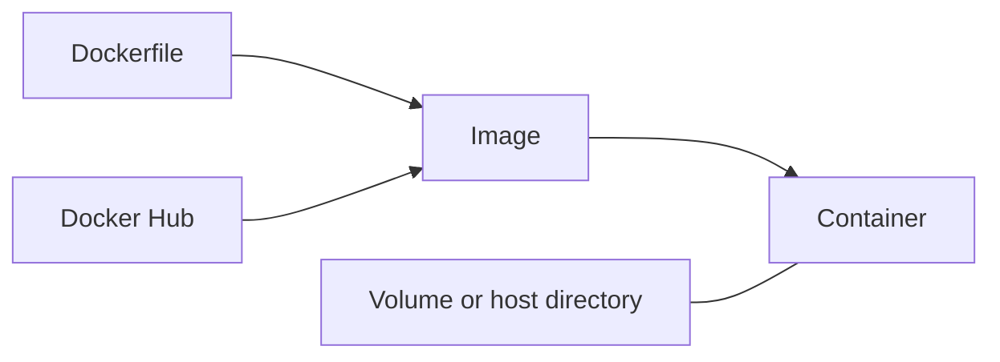
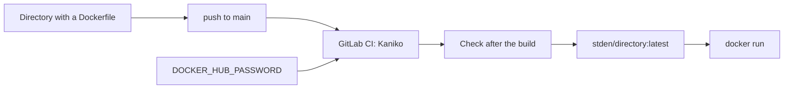
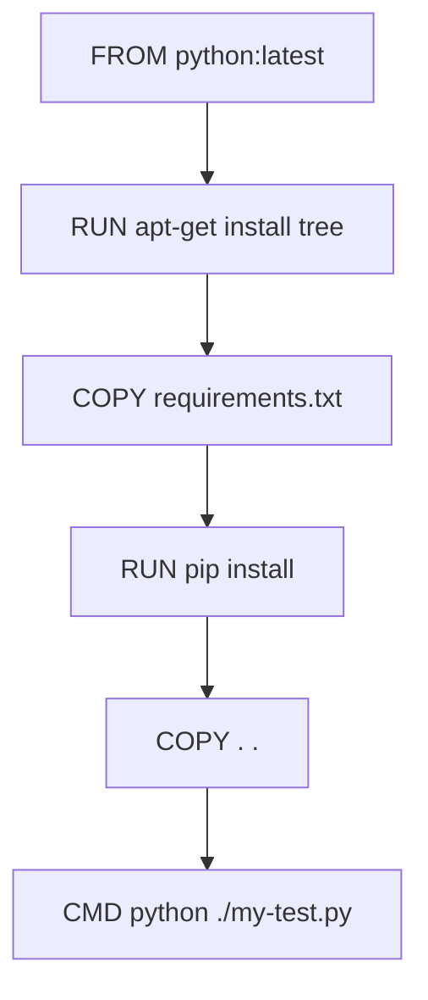
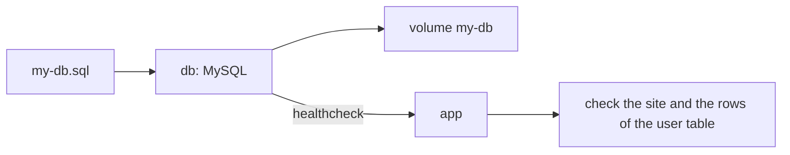

Docker image tutorial
=====================

This repository contains Docker images and examples for the lesson **“What Docker is and how it can help QA”**.

🐳 Docker runs the containers. You supply the coffee.

Use this tutorial to build, test, publish, and run Docker images.
The examples use Bash on Linux, macOS, or Windows with WSL.
The paired `.cmd` scripts support the existing Windows examples.

Each top-level directory with a `Dockerfile` defines a separate image.
GitHub Actions builds each image and publishes it as `stden/<directory>:latest`.
The published images are for `linux/amd64`.
Find the published images on [Docker Hub: stden](https://hub.docker.com/u/stden).

Follow these sections:

1. [Learn the Docker terms](#how-docker-works).
2. [Install Docker](#install-and-set-up-docker).
3. [Build and publish an image](#tutorial-build-test-and-publish-an-image).
4. [Run an application](#tutorial-run-a-local-api).
5. [Run Python and MySQL with Compose](#docker-compose-python-and-mysql).
6. [Check problems](#troubleshooting).
7. [Remove the course resources](#clean-up-the-course-resources).
8. [Use the Claude Code prompt](#claude-code-prompt).

How Docker works
----------------

A `Dockerfile` describes an image. A registry or a local machine stores the image.
An image does not run by itself. The `docker run` command creates a container from the image.
Store data in a volume or a host directory to keep it after you remove the container.



| Term | What it is |
|------|------------|
| Image | A filesystem and a start command. It does not run by itself. |
| Container | A running instance of an image. You can stop it and remove it. |
| Dockerfile | Instructions that `docker build` uses to build an image. |
| Volume | Storage outside the container. The data remains after you remove the container. |
| Registry | A server that stores images. This course uses Docker Hub and the account `stden`. |
| Tag | A version label. This course uses the tag `latest` for its images. |

Images
------

🧰 Choose an image for your task. You do not have to collect them all.

| Image overview | Base image | Contents | Docker Hub | Search categories |
| --- | --- | --- | --- | --- |
| [`compilers`](compilers/README.md) | `debian:stable-slim` | C++ (g++), C# (Mono), D (DMD), Free Pascal, Python 3 with numpy and pandas, LaTeX | [Overview](https://hub.docker.com/r/stden/compilers) · [Tags](https://hub.docker.com/r/stden/compilers/tags) | Languages & frameworks, Developer tools |
| [`cpp`](cpp/README.md) | `gcc:latest` | GCC, CMake, code coverage (gcovr, lcov), memory checks (valgrind) | [Overview](https://hub.docker.com/r/stden/cpp) · [Tags](https://hub.docker.com/r/stden/cpp/tags) | Developer tools, Languages & frameworks |
| [`java`](java/README.md) | `maven:3-amazoncorretto-25` | JDK 25 (LTS) and Maven for Java builds and tests | [Overview](https://hub.docker.com/r/stden/java) · [Tags](https://hub.docker.com/r/stden/java/tags) | Languages & frameworks, Developer tools, Integration & delivery |
| [`java-eks`](java-eks/README.md) | `amazoncorretto:25` | A Spring Boot 4 REST API for AWS EKS. See [java-eks/README.md](java-eks/README.md). | [Overview](https://hub.docker.com/r/stden/java-eks) · [Tags](https://hub.docker.com/r/stden/java-eks/tags) | Languages & frameworks, Web servers |
| [`java-run-swing`](java-run-swing/README.md) | `alpine:latest` | OpenJDK 25 and a virtual X server (Xvfb) for Swing applications without a monitor | [Overview](https://hub.docker.com/r/stden/java-run-swing) · [Tags](https://hub.docker.com/r/stden/java-run-swing/tags) | Languages & frameworks, Developer tools |
| [`java-ui-browser`](java-ui-browser/README.md) | `eclipse-temurin:27-jdk-resolute` | JDK 27, Gradle 9.8.2, Google Chrome, git, and Python 3 for Java UI tests in a browser | [Overview](https://hub.docker.com/r/stden/java-ui-browser) · [Tags](https://hub.docker.com/r/stden/java-ui-browser/tags) | Developer tools, Integration & delivery, Languages & frameworks |
| [`latex`](latex/README.md) | `texlive/texlive:latest` | TeX Live (full scheme), sshpass, C++ tools with Boost.Filesystem | [Overview](https://hub.docker.com/r/stden/latex) · [Tags](https://hub.docker.com/r/stden/latex/tags) | Developer tools, Languages & frameworks |
| [`my-python-app`](my-python-app/README.md) | `python:latest` | A course application that checks a website and reads a MySQL table | [Overview](https://hub.docker.com/r/stden/my-python-app) · [Tags](https://hub.docker.com/r/stden/my-python-app/tags) | Languages & frameworks, Developer tools |
| [`python`](python/README.md) | `python:latest` | Python, uv, pytest, Behave, Ruff, and mypy to test and check Python code | [Overview](https://hub.docker.com/r/stden/python) · [Tags](https://hub.docker.com/r/stden/python/tags) | Languages & frameworks, Developer tools, Integration & delivery |
| [`rust`](rust/README.md) | `rust:latest` | rustc, Cargo, rustfmt, and Clippy for Rust builds and checks | [Overview](https://hub.docker.com/r/stden/rust) · [Tags](https://hub.docker.com/r/stden/rust/tags) | Languages & frameworks, Developer tools |
| [`rust-node`](rust-node/README.md) | `rust:latest` and `node:latest` | Rust and Node.js tools for full-stack builds, with OpenSSL development libraries | [Overview](https://hub.docker.com/r/stden/rust-node) · [Tags](https://hub.docker.com/r/stden/rust-node/tags) | Languages & frameworks, Developer tools, Integration & delivery |
| [`web-qa`](web-qa/README.md) | `python:latest` and `node:latest` | Playwright, Chrome, pytest, Behave, Lighthouse, and accessibility checks | [Overview](https://hub.docker.com/r/stden/web-qa) · [Tags](https://hub.docker.com/r/stden/web-qa/tags) | Developer tools, Integration & delivery, Languages & frameworks |
| [`document-tools`](document-tools/README.md) | `python:latest` | Typst, LibreOffice, Poppler, fonts, and uv for document conversion | [Overview](https://hub.docker.com/r/stden/document-tools) · [Tags](https://hub.docker.com/r/stden/document-tools/tags) | Developer tools, Languages & frameworks |
| [`rust-ci`](rust-ci/README.md) | `rust:latest` | Nextest, coverage (llvm-cov, tarpaulin), cargo-deny, cargo-audit, sqlx-cli, cargo-mutants, sccache, and fast linkers | [Overview](https://hub.docker.com/r/stden/rust-ci) · [Tags](https://hub.docker.com/r/stden/rust-ci/tags) | Developer tools, Integration & delivery, Languages & frameworks |
| [`rust-desktop`](rust-desktop/README.md) | `rust:latest` | GTK, X11/XCB libraries, Xvfb, sccache, and Rust coverage tools | [Overview](https://hub.docker.com/r/stden/rust-desktop) · [Tags](https://hub.docker.com/r/stden/rust-desktop/tags) | Languages & frameworks, Developer tools |
| [`python-media`](python-media/README.md) | `python:latest` | FFmpeg, ffprobe, and uv to process audio and video | [Overview](https://hub.docker.com/r/stden/python-media) · [Tags](https://hub.docker.com/r/stden/python-media/tags) | Developer tools, Languages & frameworks |
| [`cpp-vulkan`](cpp-vulkan/README.md) | `ubuntu:latest` | C++ build tools, Vulkan headers, shader tools, and a software Vulkan driver | [Overview](https://hub.docker.com/r/stden/cpp-vulkan) · [Tags](https://hub.docker.com/r/stden/cpp-vulkan/tags) | Developer tools, Languages & frameworks |
| [`cpp-cuda`](cpp-cuda/README.md) | `nvidia/cuda:13.4.3-devel-ubuntu26.04` | CUDA compiler, CMake, and C++ tools for NVIDIA GPU programs | [Overview](https://hub.docker.com/r/stden/cpp-cuda) · [Tags](https://hub.docker.com/r/stden/cpp-cuda/tags) | Developer tools, Languages & frameworks |
| [`postgres-vector-graph`](postgres-vector-graph/README.md) | `postgres:18` | PostgreSQL with pgvector and Apache AGE for vector and graph queries | [Overview](https://hub.docker.com/r/stden/postgres-vector-graph) · [Tags](https://hub.docker.com/r/stden/postgres-vector-graph/tags) | Databases & storage, Data science, Languages & frameworks |
| [`graphify`](graphify/README.md) | `python:latest` | Graphify knowledge graphs of code and documents, with an MCP server and an mcpo OpenAPI server | [Overview](https://hub.docker.com/r/stden/graphify) · [Tags](https://hub.docker.com/r/stden/graphify/tags) | Developer tools, Machine learning & AI, Languages & frameworks |
| [`codegraph`](codegraph/README.md) | `node:latest` | CodeGraph code index with symbol, caller, impact, and affected-test queries, an MCP server, and an mcpo OpenAPI server | [Overview](https://hub.docker.com/r/stden/codegraph) · [Tags](https://hub.docker.com/r/stden/codegraph/tags) | Developer tools, Machine learning & AI, Languages & frameworks |
| [`open-webui`](open-webui/README.md) | `ghcr.io/open-webui/open-webui:latest` | Open WebUI chat interface for Ollama and OpenAI-compatible APIs, with the embedding models | [Overview](https://hub.docker.com/r/stden/open-webui) · [Tags](https://hub.docker.com/r/stden/open-webui/tags) | Machine learning & AI, Web servers, Languages & frameworks |
| [`argocd`](argocd/README.md) | `quay.io/argoproj/argocd:v3.5.6` | Argo CD for GitOps on Kubernetes and EKS, with the argocd CLI, helm, and kustomize | [Overview](https://hub.docker.com/r/stden/argocd) · [Tags](https://hub.docker.com/r/stden/argocd/tags) | Integration & delivery, Developer tools, Languages & frameworks |
| [`crossplane`](crossplane/README.md) | `amazon/aws-cli:latest` | The crossplane CLI, kubectl, helm, and the AWS CLI to install and use Crossplane on EKS | [Overview](https://hub.docker.com/r/stden/crossplane) · [Tags](https://hub.docker.com/r/stden/crossplane/tags) | Integration & delivery, Developer tools, Languages & frameworks |
| [`code-quality`](code-quality/README.md) | `debian:stable-slim` | gitleaks, hadolint, shellcheck, actionlint, typos, and semgrep for static checks in CI | [Overview](https://hub.docker.com/r/stden/code-quality) · [Tags](https://hub.docker.com/r/stden/code-quality/tags) | Developer tools, Security, Languages & frameworks |
| [`allure`](allure/README.md) | `node:slim` | Allure Report 3 and Allure Report 2 to generate test reports from pytest, Java, Behave, and Playwright results | [Overview](https://hub.docker.com/r/stden/allure) · [Tags](https://hub.docker.com/r/stden/allure/tags) | Developer tools, Integration & delivery, Languages & frameworks |
| [`php`](php/README.md) | `php:latest` | PHP CLI, Composer, PHPUnit, pcov coverage, and common extensions | [Overview](https://hub.docker.com/r/stden/php) · [Tags](https://hub.docker.com/r/stden/php/tags) | Languages & frameworks, Developer tools, Integration & delivery |
| [`android`](android/README.md) | `eclipse-temurin:25-jdk` | JDK 25, the Android SDK (platforms 34 to 37, build-tools), and Gradle to build and test Android apps | [Overview](https://hub.docker.com/r/stden/android) · [Tags](https://hub.docker.com/r/stden/android/tags) | Developer tools, Integration & delivery, Languages & frameworks |

Each image overview contains a pull command, run examples, and tool details.
The Docker Hub search categories help users find an image by its purpose.
The `latest` image tag points to the most recent tested image published from `main`.
Tool versions can change after a new build. Open **Tags** to examine the current image.

Select an image
---------------

| Task | Image |
|------|-------|
| Compile and run programs in several languages | [`compilers`](compilers/) |
| Build C++, measure coverage, and check memory | [`cpp`](cpp/) |
| Build a Java project and run Maven tests | [`java`](java/) |
| Start a REST API and open Swagger UI | [`java-eks`](java-eks/) |
| Run a Swing application without a monitor | [`java-run-swing`](java-run-swing/) |
| Run Java UI tests in Chrome | [`java-ui-browser`](java-ui-browser/) |
| Build a PDF from LaTeX | [`latex`](latex/) |
| Check a website and read a table from MySQL | [`my-python-app`](my-python-app/) and [docker-compose.yml](docker-compose.yml) |
| Run pytest and Behave tests, and check code with Ruff and mypy | [`python`](python/) |
| Build a Rust project, format the code, and run Clippy | [`rust`](rust/) |
| Build a Rust backend and a Node.js frontend | [`rust-node`](rust-node/) |
| Run browser, accessibility, and performance checks | [`web-qa`](web-qa/) |
| Create PDFs or convert office documents | [`document-tools`](document-tools/) |
| Run Rust CI tests with coverage, license, mutation, and database migration tools | [`rust-ci`](rust-ci/) |
| Build and test a Rust desktop application | [`rust-desktop`](rust-desktop/) |
| Convert audio and video files | [`python-media`](python-media/) |
| Compile Vulkan shaders and C++ programs | [`cpp-vulkan`](cpp-vulkan/) |
| Compile CUDA programs | [`cpp-cuda`](cpp-cuda/) |
| Store vectors and query graphs in PostgreSQL | [`postgres-vector-graph`](postgres-vector-graph/) |
| Map code and documents into a knowledge graph for an AI assistant | [`graphify`](graphify/) |
| Index code for an AI assistant and find the tests for a change | [`codegraph`](codegraph/) |
| Chat with local or remote language models in a browser | [`open-webui`](open-webui/) |
| Deploy applications from git to Kubernetes (GitOps) | [`argocd`](argocd/) |
| Manage AWS resources as Kubernetes objects | [`crossplane`](crossplane/) |
| Find secrets, Dockerfile, shell, workflow, and spelling problems | [`code-quality`](code-quality/) |
| Make HTML test reports from test results | [`allure`](allure/) |
| Test a PHP project with PHPUnit and coverage | [`php`](php/) |
| Build, test, and lint an Android app | [`android`](android/) |

The base images use the `latest` tag if it is compatible with the tools.
The `java`, `java-eks`, `java-run-swing`, and `android` images use the newest Java
long-term support (LTS) version.
The `java-ui-browser` image uses the current JDK 27.
Each build gets the current compilers and libraries.

CUDA uses a published toolkit tag. PostgreSQL stays on the major version that Apache AGE supports.
Argo CD uses the newest stable release tag, because the upstream `latest` tag is a nightly build.
These tags keep the tools compatible. The builds still pull the current updates of the base images.

Use these example commands:

```sh
# Compile and run “Hello world” in five languages
docker run --rm stden/compilers

# Run a Swing application without a monitor
docker run --rm -v "$PWD":/app stden/java-run-swing xvfb-run -a java -jar my-app.jar

# Run Java UI tests
# Mount the directory that contains build.gradle at /workspace
docker run --rm -v "$PWD":/workspace stden/java-ui-browser gradle test

# Build a PDF from LaTeX
docker run --rm -v "$PWD":/work -w /work stden/latex pdflatex doc.tex

# Build the Java project in the current directory
docker run --rm -v "$PWD":/workspace stden/java mvn verify

# Run Python tests
docker run --rm -v "$PWD":/workspace stden/python pytest
# Check Python code style
docker run --rm -v "$PWD":/workspace stden/python ruff check .

# Build and test the Rust project
docker run --rm -v "$PWD":/workspace stden/rust cargo test
# Check the Rust code format
docker run --rm -v "$PWD":/workspace stden/rust cargo fmt --check
# Check the Rust code with Clippy
docker run --rm -v "$PWD":/workspace stden/rust cargo clippy
```

Use the shared tool images
--------------------------

These images contain reusable tools. Mount your project at `/workspace`.
Project dependencies stay in your project.

```sh
# Build a project that has both Cargo.toml and package.json
docker run --rm -v "$PWD":/workspace stden/rust-node bash -c 'cargo test && npm ci && npm test'

# Run Python browser tests
docker run --rm --shm-size=1g -v "$PWD":/workspace stden/web-qa pytest

# Compile a Typst document
docker run --rm -v "$PWD":/workspace stden/document-tools typst compile doc.typ doc.pdf

# Convert a Word document to PDF
docker run --rm -v "$PWD":/workspace stden/document-tools libreoffice --headless --convert-to pdf --outdir /workspace report.docx

# Run Rust tests with Nextest
docker run --rm -v "$PWD":/workspace stden/rust-ci cargo nextest run

# Run desktop tests with a virtual display
docker run --rm -v "$PWD":/workspace stden/rust-desktop xvfb-run -a cargo test

# Convert an audio file
docker run --rm -v "$PWD":/workspace stden/python-media ffmpeg -i input.wav output.mp3

# Compile a GLSL shader
docker run --rm -v "$PWD":/workspace stden/cpp-vulkan glslc shader.comp -o shader.spv

# Compile a CUDA program
docker run --rm -v "$PWD":/workspace stden/cpp-cuda nvcc main.cu -o app

# Build a Graphify knowledge graph of the code
docker run --rm -v "$PWD":/workspace stden/graphify graphify extract . --code-only

# Index the code with CodeGraph and find the callers of a function
docker run --rm -v "$PWD":/workspace stden/codegraph bash -c 'codegraph init . && codegraph callers main'
```

You can compile CUDA code without a GPU. To run a CUDA kernel, use a compatible NVIDIA GPU
and host driver, and the NVIDIA Container Toolkit. Then add `--gpus all` to `docker run`.
The CI smoke test compiles and links CUDA code. It does not run a GPU kernel.
The Vulkan smoke test uses a software driver, so a physical GPU is not necessary.

The `web-qa` build installs the browser revision that matches its Playwright package.
When you add project dependencies, make sure that these versions match.
The CI browser checks use local test pages.

Start a local chat interface for language models. The tutorial in
[open-webui/README.md](open-webui/README.md) shows how to connect Ollama, update to a new
release, and make a backup of the data.

```sh
openssl rand -hex 32 > webui-secret.key
docker run -d --name open-webui -p 127.0.0.1:3000:8080 \
  -e WEBUI_SECRET_KEY="$(cat webui-secret.key)" \
  -v open-webui:/app/backend/data stden/open-webui
```

Start a local vector and graph database:

```sh
# Use a separate password for any real deployment. This value is a local example.
docker run -d --name docker-gems-graph -p 127.0.0.1:5432:5432 \
  -e POSTGRES_PASSWORD=change-me \
  -v docker-gems-graph-data:/var/lib/postgresql \
  stden/postgres-vector-graph

# Wait for the final server. Its temporary setup server has no TCP listener.
docker exec docker-gems-graph bash -c '
  for attempt in {1..60}; do
    pg_isready -h 127.0.0.1 -U postgres -d postgres && exit 0
    sleep 1
  done
  echo "PostgreSQL did not start within 60 seconds." >&2
  exit 1
'

# Enable the extensions after the readiness check passes
docker exec docker-gems-graph psql -U postgres -v ON_ERROR_STOP=1 \
  -c 'CREATE EXTENSION IF NOT EXISTS vector;' \
  -c 'CREATE EXTENSION IF NOT EXISTS age;'

# Open a SQL session
docker exec -it docker-gems-graph psql -U postgres
```

Before you use AGE functions, run two commands in the SQL session:
`LOAD 'age';` and `SET search_path = ag_catalog, public;`.
Keep the named volume when you stop or replace the container.
Do not use this volume with a different PostgreSQL major version without a database migration.

Map a codebase for an AI assistant
----------------------------------

🧠 The graph gives the assistant a map. It reads less and finds more.

Graphify and CodeGraph both convert a project into a graph. An AI assistant then
queries the graph. It does not read every file. Both tools work offline for code.

| Question | `graphify` | `codegraph` |
| --- | --- | --- |
| What does the graph contain? | Code, and also documents, papers, and images with a language model | Source code only |
| Where is the graph? | `graphify-out/graph.json`, a report, and an HTML view | `.codegraph/codegraph.db`, a SQLite database |
| How does it stay current? | Run `graphify update .` | Run `codegraph sync .`, or let the MCP server watch the files |
| How does an HTTP client use it? | `graphify-mcp` over HTTP, or mcpo as an OpenAPI server | mcpo as an OpenAPI server. The MCP server uses only stdio. |
| What is it best for? | Architecture reviews and a shared project map | Callers, impact, and the tests affected by a change |

The tutorials in [graphify/README.md](graphify/README.md) and
[codegraph/README.md](codegraph/README.md) show each step:

- Exclude files (`graphify` only).
- Build the graph, query it, and update it.
- Connect an assistant over MCP.
- Connect Open WebUI through mcpo.

Each tutorial also lists best practices. The smoke tests of the two images run the same steps.

```sh
# Run the tool as your user, so the output files belong to you
docker run --rm --user "$(id -u):$(id -g)" -v "$PWD":/workspace stden/graphify \
  bash -c 'graphify extract . --code-only && graphify cluster-only . --no-label'
docker run --rm --user "$(id -u):$(id -g)" -v "$PWD":/workspace stden/codegraph \
  bash -c 'codegraph init . && codegraph status .'
```

You can also extend an image in your own Dockerfile:

```dockerfile
FROM stden/rust-node:latest
WORKDIR /workspace
COPY . .
RUN cargo build --release
```

Check the images
----------------

The `test-images.sh` script checks that the programs in an image work.
With no arguments, the script builds every image with the tag `:test`.
Use `--no-build` to check an image with the tag `:latest`.
This option does not call `docker build`.

```sh
./test-images.sh
./test-images.sh java rust
./test-images.sh --no-build java
```

The `up.sh` and `up.cmd` scripts build the image and run `test-images.sh --no-build`.
They publish the image only if the check passes. The `up.cmd` script calls `bash`.
The eighteen shared tool images use the publish helper [ci/publish-image.sh](ci/publish-image.sh).
The helper also stops if the current branch is not `main`.

GitHub Actions runs `./test-images.sh --no-build <image>` after each image build.
The runner has Docker, so it runs the full container checks.
The eighteen shared tool images each have a `smoke-test.sh` file. The test runner mounts the file
and runs functional checks inside the image. The database and Open WebUI tests use
temporary data directories.

The backup GitLab CI pipeline uses a different runner.
Kaniko saves the image as an archive.
The `ci/test-built-image.sh` script runs the programs from that archive with PRoot.
GitLab CI publishes the image only if the check passes.
Its build machine has no Docker daemon because the runner is not privileged.

For `my-python-app`, the `test-images.sh` script runs `docker compose` twice with MySQL.
GitHub Actions runs this full Compose check.
In GitLab CI, the check confirms that Python can import the image's libraries and compiles
`my-test.py` and `my-sql-test.py`.
The GitLab runner cannot start Compose.

Build and publish
-----------------

### GitHub Actions

The main workflow is [.github/workflows/docker-images.yml](.github/workflows/docker-images.yml).
It finds every top-level `*/Dockerfile`.
Each image gets a separate matrix job on an `ubuntu-24.04` runner.
Before the image jobs start, the `find-images` job runs `bash ci/test-smoke-failures.sh`,
the `ci/test_hub_metadata.py` unit tests, and `python3 ci/hub_metadata.py --check`.
If one of these checks fails, no image job starts.

Each job follows this order:

1. Build the image with `docker build --pull --no-cache -t <image>:latest <image>`.
2. Test it with `./test-images.sh --no-build <image>`.
3. For `graphify`, `codegraph`, `java-eks`, `argocd`, and `crossplane`, deploy the Kubernetes
   manifests to a kind cluster with `bash ci/test-kubernetes.sh <image>`.
   A failed deployment stops the job.
4. Tag the tested image as `stden/<image>:latest`.
5. If the event allows it, publish that image to Docker Hub.
6. Update its Docker Hub overview, short description, and search categories. Verify the saved values.

On `main`, the job logs in to Docker Hub before the build.
The login authenticates the pulls of the base images.

If a test fails, that job does not publish its image.
The workflow publishes the same image that passed the test.
The `--pull` option checks for a newer base image.
The `--no-cache` option runs the build steps again. It also installs the packages again.

🤖 The pipeline runs the same checks again. It has excellent patience.

### Read the build log

Open a workflow run in the GitHub **Actions** tab. Select the job for the image.

The log uses cyan for build and publish headings, yellow for tests, green for success, and red for failure.
The build step shows Docker output directly.
Expand the other log groups to see the Dockerfile, Docker versions, disk space, or test output.
Each test names the capability that it checks.
Failed application tests print container logs before cleanup.

The job summary shows the result of each build, smoke test, Kubernetes test, login, publish,
and overview step.
If a job fails, start with its failed step. Check the error output and the diagnostic group.

The workflow runs on every push to any branch or tag.
This includes a push that changes only documentation.
The workflow also runs for a pull request to `main` that changes a subdirectory,
`docker-compose.yml`, `test-images.sh`, or the workflow file.

| Event | Build and test | Publish to Docker Hub |
|-------|----------------|-----------------------|
| Push to `main` | Every image | Yes, after its test passes |
| Push to another branch or a tag | Every image | No |
| Pull request to `main` | Every image | No |
| Manual run on `main` | Every image | Yes, after its test passes |
| Manual run on another branch | Every image | No |

The main repository already has the `DOCKER_HUB_TOKEN` secret.
To publish from a new repository or with a new token, do these steps:

1. Create a Docker Hub personal access token for the `stden` account.
   Select **Repo Read, Write, Delete**. Docker Hub uses this permission to push images
   and to manage repository overviews and categories.
   See [Docker's token instructions](https://docs.docker.com/security/access-tokens/personal-access-tokens/).
2. Open the GitHub repository settings.
3. Select **Secrets and variables → Actions**.
4. Add a repository secret named `DOCKER_HUB_TOKEN`.
5. Put the token in that secret.

The workflow uses the fixed Docker Hub username `stden`.
Store the token in the GitHub secret. Do not put it in the repository or in a chat.
See [GitHub's secret instructions](https://docs.github.com/en/actions/how-tos/write-workflows/choose-what-workflows-do/use-secrets).

To run the workflow manually, open **Actions → Docker images → Run workflow**.
Select `main` to publish the images.

### Maintain Docker Hub overviews

Edit `<image>/README.md` to change that image's public overview.
Line 1 is `# stden/<image>`. Line 2 is empty.
Line 3 is the short description: one line of at most 100 bytes.
Keep the complete file below 25000 bytes.
Use absolute links so they work on both GitHub and Docker Hub.
Edit [ci/hub-categories.json](ci/hub-categories.json) to select one to three search
categories for each image. Include `languages-and-frameworks` for every image.
The workflow uses the existing `DOCKER_HUB_TOKEN` secret to publish these fields after the image push.

Check the content before you push:

```sh
python3 ci/hub_metadata.py --check
python3 -m unittest discover -s ci -p test_hub_metadata.py
```

For example, see the [document-tools overview](https://hub.docker.com/r/stden/document-tools)
and its [image tags](https://hub.docker.com/r/stden/document-tools/tags).

To update all pages without an image build, open **Actions → Hub pages → Run workflow**.
Then select `main`.
Use this workflow after you change the token permissions, or to try failed page updates again.
If the API returns HTTP 403, check that the personal access token has **Repo Read, Write, Delete**.
See [Docker's permission reference](https://docs.docker.com/security/access-tokens/reference/).

### GitLab CI backup

**GitLab CI** ([.gitlab-ci.yml](.gitlab-ci.yml)) builds and publishes every image after a push to `main`
that changes a file in a subdirectory or `.gitlab-ci.yml`.
The rule matches each subdirectory, for example an image directory, `ci/`, or `aws/`.
This configuration stays in the GitLab repository at `origin-backup`.
It publishes the images to Docker Hub when you push to that remote.



- The builder is [Kaniko](https://github.com/osscontainertools/kaniko).
  It works without a Docker daemon. It can build images on a runner that is not privileged.
- The CI/CD variable `DOCKER_HUB_PASSWORD` stores the Docker Hub password.
  This variable has the Protected and Masked settings.
  GitLab supplies protected variables only to protected branches.
  Add `main` to Settings → Repository → Protected branches.
  If `main` is not protected, the pipeline gets an empty password.
  Docker Hub then returns `UNAUTHORIZED: authentication required`.
- To get new base image versions without a code change, start a pipeline manually or use a schedule.
  For a manual run, select Build → Pipelines → Run pipeline.
  For a schedule, select Build → Pipeline schedules.

| Condition | Result |
|-----------|--------------|
| A push to `main` changes a file in a subdirectory or `.gitlab-ci.yml` | CI builds, checks, and publishes every image |
| A push changes only files in the repository root, such as this README | The pipeline does not start |
| A manual or scheduled run | CI builds the images again from the current base tags |
| `main` is not a protected branch | The password is empty. Docker Hub returns `UNAUTHORIZED`. |

### Existing publish scripts

Use the scripts in the image directory for a manual build.
The `up` scripts publish to the `stden` account.
To use them, you must have write access to that account.
Use the tutorial below to publish a course image to your own account.

| Script | Function |
|--------|--------------|
| `up.sh` / `up.cmd` | Build the image. Check the image. Publish it to Docker Hub only if the check passes. |
| `r.sh` / `r.cmd` | Build the image. Run it locally. |

Install and set up Docker
=========================

🛠️ Install Docker once. The examples then run the same way on every machine.

- Windows: install [Docker Desktop](https://docs.docker.com/desktop/setup/install/windows-install/).
- macOS: install [Docker Desktop](https://docs.docker.com/desktop/setup/install/mac-install/).
  You can also use Homebrew:

  ```sh
  brew install --cask docker-desktop
  ```

- Linux: install [Docker Engine](https://docs.docker.com/engine/install/).

Check the installed Docker version:

```sh
docker --version
```

Example output:

```
Docker version 29.8.1, build 4a63305
```

Check that Docker works:

```sh
docker run hello-world
```

The [hw.sh](hw.sh) and [hw.cmd](hw.cmd) scripts run the same check.

Log in to Docker Hub from the command line before you publish images:

```sh
docker login
```

Tutorial: build, test, and publish an image
=========================================

This example uses the existing `python/Dockerfile`.
You must have Git, Docker, and a Docker Hub account with permission to publish images.
Run the steps in the same Bash session.

🧪 Build first. Test next. Celebrate after the tests pass.

### 1. Get the course files

Clone the repository with an SSH key that GitHub accepts:

```sh
git clone git@github.com:stden/docker-gems.git
```

Open the repository directory:

```sh
cd docker-gems
```

If you already have the repository, open its root directory instead.
Run the remaining commands from that directory.

### 2. Build the image

```sh
docker build --pull -t python:latest python
```

The last `python` is the build context directory.
Docker reads `python/Dockerfile` from that directory.
The `--pull` option checks for a newer base image.
The `-t` option names the result `python:latest`.

### 3. Test the image

```sh
./test-images.sh --no-build python
```

This smoke test checks Python, uv, pytest, Behave, Ruff, and mypy in the built image.
Fix a failed test before you publish the image.

### 4. Set your Docker Hub username

Replace `your-docker-hub-user` with your Docker Hub username:

```sh
DOCKER_HUB_USER=your-docker-hub-user
```

### 5. Log in to Docker Hub

```sh
docker login --username "$DOCKER_HUB_USER"
```

Enter your personal access token at the password prompt.
Do not put the token in a command, a Dockerfile, a source file, or a chat message.
See [Docker's login instructions](https://docs.docker.com/security/access-tokens/personal-access-tokens/).

### 6. Tag and publish the tested image

A tag gives the local image a registry name.
The `docker push` command uploads that image.
See [Docker's build and publish guide](https://docs.docker.com/get-started/docker-concepts/building-images/build-tag-and-publish-an-image/).

Run the check again as part of the publish sequence:

```sh
./test-images.sh --no-build python &&
docker tag python:latest "$DOCKER_HUB_USER/python:latest" &&
docker push "$DOCKER_HUB_USER/python:latest"
```

Each `&&` runs the next command only if the previous command succeeds.
If the check fails, the shell does not run the tag and push commands.

### 7. Pull the published image

```sh
docker pull "$DOCKER_HUB_USER/python:latest"
```

You can run this command on another machine with Docker.
Set `DOCKER_HUB_USER` on that machine first.

### 8. Run the published image

```sh
docker run --rm "$DOCKER_HUB_USER/python:latest" python --version
```

The container prints the Python version and exits.
The `--rm` option removes this container after it exits.
The image remains on the machine for the next run.

Tutorial: run a local API
========================

This example deploys the published `java-eks` image to your local Docker machine.
The image name contains `eks`, but an EKS or Kubernetes cluster is not necessary.

🚀 Start the API. Save the countdown for the demo.

1. Pull the image:

   ```sh
   docker pull stden/java-eks:latest
   ```

2. Start the course container:

   ```sh
   docker run -d --name docker-gems-api -p 127.0.0.1:8080:8080 stden/java-eks:latest
   ```

3. Read its startup log:

   ```sh
   docker logs docker-gems-api
   ```

4. After startup, check the API:

   ```sh
   curl --fail --include http://127.0.0.1:8080/api/health
   ```

The response must have status `200`.
Open [Swagger UI](http://127.0.0.1:8080/swagger-ui/index.html) to try the API.
The API description is at [api-docs](http://127.0.0.1:8080/api-docs).

The port mapping sends local port `8080` to container port `8080`.
The `127.0.0.1` address limits access to this machine.
See [Docker's port mapping guide](https://docs.docker.com/get-started/docker-concepts/running-containers/publishing-ports/).

Run the images on AWS: ECR and EKS
==================================

☁️ EKS bills by the hour. Delete the cluster after the lesson.

The [AWS guide](aws/README.md) copies the tested images to Amazon Elastic Container
Registry (ECR) and runs them on Amazon Elastic Kubernetes Service (EKS) with Auto Mode.
It starts Open WebUI, the Graphify and CodeGraph tool servers, a CodeGraph Job, and the
`java-eks` API. It connects Open WebUI to the tool servers. It also lists best
practices for EKS and the steps to delete everything after the lesson. With
[`argocd`](argocd/README.md), Argo CD deploys these applications from git. With
[`crossplane`](crossplane/README.md), Crossplane creates AWS resources, such as an ECR
repository, from Kubernetes objects.

```sh
aws/copy-to-ecr.sh open-webui graphify codegraph java-eks   # Docker Hub to ECR, same digest
eksctl create cluster -f aws/eks-cluster.yaml               # EKS with Auto Mode, about 20 minutes
kubectl apply -f aws/storageclass.yaml -f aws/ingressclass.yaml
kubectl apply -k graphify/kubernetes                        # after you create its secret
```

An EKS cluster costs money for each hour that it exists. Each image with a
`kubernetes/` directory has manifests that run as a non-root user and pass the
`restricted` Pod Security Standard. The [ci/test-kubernetes.sh](ci/test-kubernetes.sh)
script tests them in a local kind cluster without AWS.

Dockerfile: an image for a test environment
============================================

📦 The Dockerfile is the recipe. The image is the result. The container runs it.

The example uses [my-python-app/Dockerfile](my-python-app/Dockerfile).
The table describes its main instructions.

| Instruction                        | Function                                                        |
|------------------------------------|-----------------------------------------------------------------|
| `FROM python:latest`               | Uses the official Python image as the base image                |
| `RUN apt-get ... install -y tree`  | Installs the `tree` utility during the build                     |
| `WORKDIR /x`                       | Sets the working directory inside the container                 |
| `COPY requirements.txt ./`         | Copies the dependency file from the build directory             |
| `RUN pip install -r ...`           | Installs the Python libraries                                   |
| `COPY . .`                         | Copies the rest of the project files                            |
| `CMD ["python", "./my-test.py"]`   | Sets the command that the container runs when it starts          |

Docker builds layers in order from the top of the Dockerfile.
Each step becomes a separate layer:



Docker copies the dependency file before it copies the code.
After a code change, Docker uses the library layer from the cache.
It does not install the libraries again.

```sh
cd my-python-app
# Build the image
docker build -t my-python-app .
# Show the files in the container
# The --rm option removes the container when it exits
docker run --rm my-python-app tree /x
```

Return to the repository root before the Compose exercise:

```sh
cd ..
```

Docker Compose: Python and MySQL
================================

A database is necessary for the `my-python-app` application.
The [docker-compose.yml](docker-compose.yml) file describes the application's containers.
Docker Compose uses this YAML file to start the containers together.

🤝 MySQL gets ready first. Python waits its turn.

Run this example from the `docker-gems` repository root.
The project name `docker-gems-course` identifies the containers, network, and volume for this exercise.

Start the application and its database:

```sh
docker compose -p docker-gems-course up --build --abort-on-container-exit --exit-code-from app
```

Compose stops the services when the application exits.
The command returns the application's exit code.
Run it a second time to check the existing database data.



Compose starts the application in this order:

1. The `db` container starts MySQL.
   On the first start, MySQL runs [my-python-app/my-db.sql](my-python-app/my-db.sql).
   This script creates the `user` table and adds two rows.
2. The healthcheck waits until MySQL accepts connections.
3. The `app` container starts after the healthcheck passes.
   It checks a website and prints the rows of the `user` table.

MySQL stores its data in the `my-db` volume for this Compose project.
The data remains between runs.

```sh
# Stop and remove the containers
docker compose -p docker-gems-course down
# Stop and remove the containers and the database volume
# The next start runs my-db.sql again
docker compose -p docker-gems-course down -v
```

Use the command with `-v` only when you want to reset this exercise's database.
See [Docker's Compose cleanup reference](https://docs.docker.com/reference/cli/docker/compose/down/).

The `docker-compose` command uses Compose V1. Docker no longer supports Compose V1.
Use `docker compose`.

Databases in Docker
===================

🗄️ A container is temporary. A volume keeps the data.

Use the official [MySQL](https://hub.docker.com/_/mysql) or
[PostgreSQL](https://hub.docker.com/_/postgres) image to run a database.
Mount a host directory or a volume to keep the data after you remove the container.

Put the `docker run` options before the image name:

| Option | Example | Function |
|--------|---------|-----|
| `-d` | `-d` | Run the container in the background |
| `--name` | `--name mysql-x` | Give the container a name |
| `-p` | `-p 3306:3306` | Publish a port. The host port is on the left. The container port is on the right. |
| `-e` | `-e NAME=value` | Set an environment variable |
| `-v` | `-v "$DATA":/var/lib/mysql` | Mount a host directory or a volume |
| `--rm` | `--rm` | Remove the container when it exits |

| | MySQL | PostgreSQL |
|--|-------|------------|
| Image in the examples | `mysql:latest` | `postgres:latest` |
| Password variable | `MYSQL_ROOT_PASSWORD` | `POSTGRES_PASSWORD` |
| Data directory | `/var/lib/mysql` | `/var/lib/postgresql` |
| Port | `3306`, published in the example | `5432`, not published in the example |

MySQL
-----

```sh
# Start a MySQL container
export DATA=$HOME/mysql-data
docker run -d --name mysql-x -p 3306:3306 -e MYSQL_ROOT_PASSWORD=admin12345 -v "$DATA":/var/lib/mysql mysql:latest

# Put every option before the image name:
# -d                           - Run the container in the background
# --name mysql-x               - Set the container name
# -p 3306:3306                 - Allow connections to MySQL from the host machine
# -e MYSQL_ROOT_PASSWORD=...   - Set the MYSQL_ROOT_PASSWORD environment variable,
#                                which sets the MySQL root user's password
# -v "$DATA":/var/lib/mysql    - Keep data in a host directory between container starts
# mysql:latest                 - Use this image name and tag
#                               Example tags: 'latest' or 'lts'
```

The [run_mysql.sh](run_mysql.sh) script contains a similar example.

Stop the MySQL container:

```sh
docker stop mysql-x
```

Remove the MySQL container:

```sh
docker rm -f mysql-x
```

PostgreSQL
----------

```sh
# Start a PostgreSQL container
docker run -d --name my-postgres -e POSTGRES_PASSWORD=mysecretpassword postgres:latest

# Options:
# -d                           - Run the container in the background
# --name my-postgres           - Set the container name
# -e POSTGRES_PASSWORD=...     - Set the POSTGRES_PASSWORD environment variable,
#                                which sets the postgres user's password
# postgres:latest              - Use this image name and tag
#                               Example tags: 'latest' or '18'
```

Use a volume to keep the database on the host machine.
For PostgreSQL 18 and later, mount the volume at `/var/lib/postgresql`.
Do not use `/var/lib/postgresql/data`. If you use this old path, the container does not start.

```sh
docker run -d --name my-postgres -v /my/own/datadir:/var/lib/postgresql -e POSTGRES_PASSWORD=mysecretpassword postgres:latest
```

Other examples
==============

🎮 One command starts each demo. Tetris tests the person, not the code.

| Script                                                        | Function                                                          |
|---------------------------------------------------------------|-------------------------------------------------------------------|
| [run_tetris.sh](run_tetris.sh) / [run_tetris.cmd](run_tetris.cmd) | Starts Tetris in a browser on port 81. See [run_tetris.md](run_tetris.md) for the options. |
| [run_java_eks.cmd](run_java_eks.cmd)                          | Starts `stden/java-eks` on port 82 and opens Swagger UI           |

Troubleshooting
===============

🔎 Read the logs first. A second run with more confidence rarely fixes the cause.

| Problem | Check or action |
|---------|-----------------|
| Docker cannot connect to its daemon | Start Docker Desktop or the Docker Engine service. Run `docker info` to check the connection. |
| A build cannot download its base image | Check the registry name and your network connection. Run the build again after you fix the cause. |
| A smoke test fails | Read the failed command's output. Fix the image before you publish it. |
| Docker Hub denies a push | Check the account in the image tag. Log in with a token that can write to that account. |
| The API container exits | Run `docker logs docker-gems-api`. Check the application error. |
| The health request cannot connect | Check `docker ps -a --filter name=docker-gems-api`. Wait until the API starts. Then run the request again. |
| Host port `8080` is in use | Remove the failed course container with `docker rm docker-gems-api`. Start it with `127.0.0.1:8081:8080`. Use port `8081` in requests. |
| MySQL port `3306` is in use | Check whether the course container `mysql-x` uses the port. Stop that container before you start Compose. |
| The Compose application cannot reach MySQL | Run `docker compose -p docker-gems-course logs db app` from the repository root. Check the database healthcheck. |
| MySQL does not run `my-db.sql` again | The database already has data. If you want to repeat the initial setup, reset only the course volume. |

Clean up the course resources
============================

🧹 Keep the lesson. Remove the test containers. Your disk has other plans.

Run only the commands for the examples that you started.

Stop the local API container:

```sh
docker stop docker-gems-api
```

Remove that container:

```sh
docker rm docker-gems-api
```

Stop the standalone MySQL example:

```sh
docker stop mysql-x
```

Remove that container:

```sh
docker rm mysql-x
```

Stop the standalone PostgreSQL example:

```sh
docker stop my-postgres
```

Remove that container and its anonymous volume:

```sh
docker rm -v my-postgres
```

Remove the Compose course resources from the repository root:

```sh
docker compose -p docker-gems-course down
```

To reset the course database, use `docker compose -p docker-gems-course down -v` instead.
The `-v` option deletes this project's named volume and its database data.
The MySQL host directory in the standalone example remains on your machine.

If you no longer use the local Python image tags, remove them:

```sh
docker image rm python:latest "$DOCKER_HUB_USER/python:latest"
```

This command removes the local tags. It does not delete the image from Docker Hub.

Claude Code prompt
==================

Open Claude Code in the repository root.
Complete the fields below. Then paste the prompt into Claude Code.
Supply the names of secrets or the locations of credentials. Do not supply secret values.

📝 A coding assistant must also have a destination before it can deploy.

```text
This prompt is for a Docker image for this project.
The work can include these operations: create, test, publish, deploy, and use the image.
Do only the operations that I request in the fields below.

Project and application: <path, language, purpose, and start command>
Image directory: <existing or new top-level directory>
Necessary tools and libraries: <names and project limits>
Build and test commands: <commands, or "examine the project">
Expected result: <output, files, or HTTP response>
Container ports: <ports, or "none">
Persistent data: <container paths and storage needs, or "none">
Registry image: <account/image:tag, or "local only">
Publish: <yes or no>
Deployment target: <local Docker, named remote host, named platform, or "none">
Deployment access: <Docker context, SSH host alias, or platform project name>
Host ports and URL: <mapping and service URL, or "none">
Runtime configuration: <variable names and non-secret values>
Secret source: <CI secret names or an approved credential store, not secret values>
Git delivery: <leave changes uncommitted, commit, or commit and push to a named branch>

1. Read AGENTS.md and the instructions for each directory that you change.
2. Examine the application, Dockerfiles, scripts, tests, and CI workflows.
   Use the existing project structure and version policy.
   Do not upgrade dependencies that are outside this task.
3. Create or update the Dockerfile in the specified image directory.
   If necessary, add a .dockerignore file to exclude build output and local files.
   Do not put secrets in the image, build context, source files, logs, or chat.
4. If the existing build and publish scripts fit the task, use them.
   If you change up.sh or up.cmd, keep the two files in agreement.
   Use the GitHub Actions workflow for this repository's CI.
   Keep the backup GitLab CI pipeline compatible with the image.
5. Add or update the image's smoke test.
   A new image gets a self-contained <image>/smoke-test.sh.
   test-images.sh mounts this file and runs it.
   Make sure that ci/test-built-image.sh runs the same checks.
   For a new image, update the image lists, dispatch cases, and the two README tables.
   Add its entry to ci/hub-categories.json.
   Write <image>/README.md as the Docker Hub overview.
   Add the up.sh and up.cmd pair. Update the smoke test table in AGENTS.md.
   The full checklist is in .claude/skills/add-docker-image/SKILL.md.
6. Build the image.
   Then run the necessary tests.
   Check the startup command, necessary tools, ports, and persistent data.
   Fix failures before you publish or deploy.
7. If Publish is yes, tag the exact image that passed the tests.
   Then push that image.
   Use credentials from the supplied secret source.
   Do not rebuild the image between its test and its push.
8. If I supply a deployment target, deploy to that target.
   Use the specified ports, configuration, and storage.
   Do not assume that the target uses Kubernetes.
   Make sure that the container or service gives the expected result.
   If logs and health endpoints apply, check them.
9. Show the commands to pull, run, inspect, stop, and remove this image's containers.
   Limit cleanup commands to this project's resources.
10. Write documentation, comments, messages, and commit messages in Simplified Technical English.
    Use short sentences, active voice, consistent terms, and one instruction per step.
11. Follow the Git delivery field.
    Keep the changes that are outside this task.
12. Report the files changed, image name, test results, and deployment result.
    State any remaining blocker and the exact information that is necessary to remove it.

Continue with the work that these fields authorize.
Ask me only if necessary information is missing or if an action is outside this scope.
Do not ask me to approve a step that I already authorized.
```
