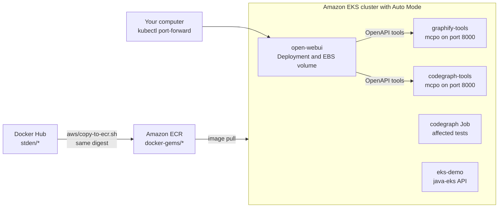

# Run the images on AWS: ECR and EKS

This guide copies the tested images from Docker Hub to Amazon Elastic Container Registry
(ECR) and runs them on Amazon Elastic Kubernetes Service (EKS). You start Open WebUI, the
Graphify and CodeGraph tool servers, a CodeGraph Job, and the `java-eks` REST API. Then
you connect Open WebUI to the tool servers.

> **Costs.** When you finish, always do [step 8](#step-8-clean-up). An EKS cluster costs
> money for each hour that it exists, also when no pod runs. The cluster of this guide costs
> about USD 0.25 to 0.50 for each hour in `us-east-1` (prices of October 2026). Check the
> current [EKS prices](https://aws.amazon.com/eks/pricing/).



Contents:

- [Terms](#terms)
- [Which images run on EKS](#which-images-run-on-eks)
- [What you need](#what-you-need)
- [Step 1: Copy the images to ECR](#step-1-copy-the-images-to-ecr)
- [Step 2: Create the EKS cluster](#step-2-create-the-eks-cluster)
- [Step 3: Start Open WebUI](#step-3-start-open-webui)
- [Step 4: Start the Graphify and CodeGraph tool servers](#step-4-start-the-graphify-and-codegraph-tool-servers)
- [Step 5: Connect Open WebUI to the tool servers](#step-5-connect-open-webui-to-the-tool-servers)
- [Step 6: Start the java-eks API](#step-6-start-the-java-eks-api)
- [Step 7: Use the images from ECR](#step-7-use-the-images-from-ecr)
- [Step 8: Clean up](#step-8-clean-up)
- [Best practices for EKS](#best-practices-for-eks)
- [Test the manifests without AWS](#test-the-manifests-without-aws)
- [Troubleshooting](#troubleshooting)

## Terms

| Term | Meaning |
| --- | --- |
| AWS account | The unit that owns your AWS resources and gets the bill. |
| Region | A geographic area with its own copy of the services, for example `us-east-1`. An ECR repository and an EKS cluster belong to one Region. |
| IAM | Identity and Access Management: users, roles, and the policies that give them permissions. |
| Amazon ECR | A private container registry in your account. A repository holds the versions of one image. |
| Digest | A `sha256:...` value that identifies one image exactly. A tag such as `latest` can move to a new image. A digest cannot move. |
| Amazon EKS | Managed Kubernetes. AWS runs the Kubernetes control plane. Your pods run on EC2 instances, the nodes. |
| EKS Auto Mode | EKS also manages the nodes, the EBS storage, and the load balancers. A NodePool describes which nodes Auto Mode can start. |
| Namespace | A group of Kubernetes objects. Each application of this guide has its own namespace. |
| Pod, Deployment, Job | A pod runs containers. A Deployment makes sure that its pods continue to run. A Job runs pods until a task is complete. |
| Service | A fixed name and address for a set of pods, for example `graphify-tools.graphify.svc.cluster.local`. |
| PersistentVolumeClaim (PVC) | A request for storage. On EKS, a PVC gets an EBS volume. A StorageClass sets the volume type. |
| Ingress, ALB | An Ingress publishes HTTP services. On EKS it creates an Application Load Balancer (ALB). |
| Pod Security Standards | Security levels for pods: `privileged`, `baseline`, and `restricted`. A namespace label enforces a level. |
| kustomize | `kubectl apply -k` applies a directory of manifests. An overlay changes an image without changes to the shared files. |

## Which images run on EKS

| Image | Runs as | Manifests |
| --- | --- | --- |
| `open-webui` | Deployment with one replica, a 10 GiB EBS volume, and a Service | [open-webui/kubernetes](../open-webui/kubernetes/) |
| `graphify` | Deployment. An init container builds the graph of a git repository. mcpo serves the tools on port 8000. | [graphify/kubernetes](../graphify/kubernetes/) |
| `codegraph` | Deployment with mcpo on port 8000, and a Job that lists the tests that the last commit affects | [codegraph/kubernetes](../codegraph/kubernetes/) |
| `java-eks` | Deployment with two replicas, a Service, and an ALB Ingress. See [java-eks/README.md](../java-eks/README.md). | [java-eks/kubernetes](../java-eks/kubernetes/) |
| `argocd` | The Argo CD components, from the upstream install manifest with this image. An ApplicationSet deploys the four applications above from git (GitOps). See [argocd/README.md](../argocd/README.md). | [argocd/kubernetes](../argocd/kubernetes/), [argocd/applications](../argocd/applications/) |
| `crossplane` | The toolbox that installs Crossplane with its Helm chart, and the AWS provider for ECR with EKS Pod Identity. See [crossplane/README.md](../crossplane/README.md). | [crossplane/kubernetes](../crossplane/kubernetes/) |
| Tool images, for example `python`, `rust`, `web-qa` | A Job, for example for a CI task. Use [the CodeGraph Job](../codegraph/kubernetes/codegraph-job.yaml) as a pattern: change the image and the command. | — |
| `postgres-vector-graph` | Not included. For a database on Kubernetes, backups, upgrades, and a StatefulSet are necessary. | — |

All pods run as a non-root user with a read-only root filesystem, and every namespace
enforces the `restricted` Pod Security Standard. The images are built for linux/amd64
only. Every manifest has `nodeSelector: kubernetes.io/arch: amd64`, so a pod never goes
to a Graviton (arm64) node. The `general-purpose` NodePool of EKS Auto Mode starts amd64
nodes only.

## What you need

- An AWS account, and an IAM principal that can create EKS clusters, IAM roles, VPCs,
  and ECR repositories. In a course account, `AdministratorAccess` is the simple choice.
  Do not use the root user of the account.
- [AWS CLI](https://docs.aws.amazon.com/cli/latest/userguide/getting-started-install.html) 2.27.57 or later.
  Older versions do not have the tag mutability exclusions that `aws/copy-to-ecr.sh` uses.
  Use short-term credentials, for example IAM Identity Center with `aws configure sso`.
  Check the identity with `aws sts get-caller-identity`.
- [eksctl](https://github.com/eksctl-io/eksctl/releases) 0.231 or later.
  The official eksctl container image is older than the newest release, so install the binary.
- [kubectl](https://kubernetes.io/docs/tasks/tools/) with the minor version of the
  cluster, or one minor version newer or older. The cluster of this guide uses 1.37.
- Docker with buildx. Docker Desktop and Docker Engine include buildx.
- `openssl` and `jq`.

Run the commands from the root of this repository. Set the Region once:

```sh
export AWS_REGION=us-east-1
```

If you use another Region, also change `metadata.region` in
[aws/eks-cluster.yaml](eks-cluster.yaml).

## Step 1: Copy the images to ECR

First, enable basic image scanning for the repositories of this guide. Basic scanning
finds known vulnerabilities in operating system packages at no extra cost. If your account
already has scanning rules, read them first with `aws ecr get-registry-scanning-configuration`.
The next command replaces the scanning rules of the registry:

```sh
aws ecr put-registry-scanning-configuration --scan-type BASIC \
  --rules 'scanFrequency=SCAN_ON_PUSH,repositoryFilters=[{filter=docker-gems/*,filterType=WILDCARD}]'
```

Then copy the images:

```sh
aws/copy-to-ecr.sh open-webui graphify codegraph java-eks
```

The script [aws/copy-to-ecr.sh](copy-to-ecr.sh) does these steps for each image:

1. It creates the repository `docker-gems/<image>` if it does not exist. All tags except
   `latest` are immutable, so a version tag always means the same image. ECR encrypts the
   images with AES-256.
2. It sets the lifecycle policy [aws/ecr-lifecycle-policy.json](ecr-lifecycle-policy.json):
   untagged images expire 14 days after the push, and ECR keeps the 10 newest tagged images.
3. It logs Docker in to ECR. The login token is valid for 12 hours.
4. It copies the image with `docker buildx imagetools create --prefer-index=false`. The
   image in ECR has the same digest as the tested image on Docker Hub. The layers move
   through your computer. The `open-webui` image is about 1.6 GB.
5. It prints the image URI with the digest. You use the digest in step 7.

The variable `ECR_PREFIX` changes the repository prefix `docker-gems`. If you change it, also
change `docker-gems/` in the other commands of this guide.

Check the result and the scan findings:

```sh
aws ecr describe-images --repository-name docker-gems/open-webui \
  --query 'imageDetails[].{tags: imageTags, digest: imageDigest, pushed: imagePushedAt}'
aws ecr describe-image-scan-findings --repository-name docker-gems/open-webui \
  --image-id imageTag=latest --query 'imageScanFindings.findingSeverityCounts'
```

### Optional: copy the images with GitHub Actions

The workflow [.github/workflows/aws-ecr.yml](../.github/workflows/aws-ecr.yml) runs the
same script. It gets short-term AWS credentials through OpenID Connect (OIDC), so GitHub
stores no AWS key. Do this setup once, with your repository in place of `stden/docker-gems`:

```sh
account=$(aws sts get-caller-identity --query Account --output text)
# If the account already has this OIDC provider, skip this command.
aws iam create-open-id-connect-provider \
  --url https://token.actions.githubusercontent.com --client-id-list sts.amazonaws.com

# Repositories made after 15 July 2026 use immutable subject claims, such as
# repo:<owner>@<owner-id>/<repo>@<repo-id>. Older repositories use repo:<owner>/<repo>.
prefix=$(gh api repos/stden/docker-gems/actions/oidc/customization/sub --jq '.sub_claim_prefix // empty')
subject="${prefix:-repo:stden/docker-gems}:ref:refs/heads/main"

cat > trust-policy.json <<EOF
{
  "Version": "2012-10-17",
  "Statement": [{
    "Effect": "Allow",
    "Principal": {"Federated": "arn:aws:iam::$account:oidc-provider/token.actions.githubusercontent.com"},
    "Action": "sts:AssumeRoleWithWebIdentity",
    "Condition": {"StringEquals": {
      "token.actions.githubusercontent.com:aud": "sts.amazonaws.com",
      "token.actions.githubusercontent.com:sub": "$subject"
    }}
  }]
}
EOF
cat > ecr-push-policy.json <<EOF
{
  "Version": "2012-10-17",
  "Statement": [
    {"Effect": "Allow", "Action": "ecr:GetAuthorizationToken", "Resource": "*"},
    {"Effect": "Allow",
     "Action": ["ecr:CreateRepository", "ecr:DescribeRepositories", "ecr:PutLifecyclePolicy",
                "ecr:BatchCheckLayerAvailability", "ecr:InitiateLayerUpload", "ecr:UploadLayerPart",
                "ecr:CompleteLayerUpload", "ecr:PutImage", "ecr:BatchGetImage",
                "ecr:GetDownloadUrlForLayer"],
     "Resource": "arn:aws:ecr:$AWS_REGION:$account:repository/docker-gems/*"}
  ]
}
EOF
aws iam create-role --role-name docker-gems-ecr --assume-role-policy-document file://trust-policy.json
aws iam put-role-policy --role-name docker-gems-ecr --policy-name ecr-push \
  --policy-document file://ecr-push-policy.json

gh variable set AWS_ROLE_ARN --body "arn:aws:iam::$account:role/docker-gems-ecr"
gh variable set AWS_REGION --body "$AWS_REGION"
gh workflow run aws-ecr.yml -f images="open-webui graphify codegraph java-eks"
```

The trust policy accepts only the `main` branch. A pull request cannot get the role.

### Alternative: ECR pull through cache

An [ECR pull through cache rule](https://docs.aws.amazon.com/AmazonECR/latest/userguide/pull-through-cache.html)
copies an image from Docker Hub when a node pulls it for the first time. The image URI
is then `<account>.dkr.ecr.<region>.amazonaws.com/docker-hub/stden/<image>:latest`. The
rule must have a Docker Hub access token in AWS Secrets Manager. The cache checks Docker Hub
for a new `latest` at most once in 24 hours. For the first pull, the node role must have
`ecr:CreateRepository`, but the default node role does not have it. The copy script of
this guide does not have these limits.

## Step 2: Create the EKS cluster

```sh
eksctl create cluster -f aws/eks-cluster.yaml
```

This takes about 15 to 20 minutes. eksctl creates a VPC with public and private subnets,
a NAT gateway, the IAM roles, and the cluster with EKS Auto Mode. Then it writes the
cluster credentials to `~/.kube/config`. The file [aws/eks-cluster.yaml](eks-cluster.yaml)
also sets `upgradePolicy.supportType: STANDARD`, so the cluster does not pay for extended
support.

Add the StorageClass and the IngressClass for the load balancers.
EKS Auto Mode does not create them:

```sh
kubectl apply -f aws/storageclass.yaml -f aws/ingressclass.yaml
kubectl get storageclass
kubectl get nodes -L kubernetes.io/arch
```

Auto Mode starts a node only when it is necessary for a pod, so the node list can be empty at
first.

Only the IAM principal that created the cluster can use kubectl now. To give another
person access to one namespace, create an access entry:

```sh
aws eks create-access-entry --cluster-name docker-gems --principal-arn <role-or-user-arn>
aws eks associate-access-policy --cluster-name docker-gems --principal-arn <role-or-user-arn> \
  --policy-arn arn:aws:eks::aws:cluster-access-policy/AmazonEKSEditPolicy \
  --access-scope type=namespace,namespaces=open-webui
```

## Step 3: Start Open WebUI

```sh
kubectl apply -f open-webui/kubernetes/namespace.yaml
kubectl -n open-webui create secret generic open-webui \
  --from-literal=WEBUI_SECRET_KEY="$(openssl rand -hex 32)"
kubectl apply -k open-webui/kubernetes
kubectl -n open-webui rollout status deployment/open-webui --timeout=15m
```

The first start pulls a large image and can take some minutes. Then open the web page
from your computer:

```sh
kubectl -n open-webui port-forward service/open-webui 3000:80
```

Open <http://127.0.0.1:3000>. Then create the administrator account immediately. The first
account becomes the administrator, and then sign-up closes. To use a model, open
**Admin Panel → Settings → Connections**. Then add an OpenAI-compatible API or an Ollama
server.

The manifest [open-webui/kubernetes/open-webui.yaml](../open-webui/kubernetes/open-webui.yaml)
keeps the data on the EBS volume at `/data` (`DATA_DIR=/data`). A volume at
`/app/backend/data` hides the embedding models in the image, because Kubernetes
does not copy image files into a new volume. Keep a copy of the secret key. Without the
same key, all users must sign in again:

```sh
kubectl -n open-webui get secret open-webui -o jsonpath='{.data.WEBUI_SECRET_KEY}' | base64 -d
```

## Step 4: Start the Graphify and CodeGraph tool servers

```sh
for app in graphify codegraph; do
  kubectl apply -f "$app/kubernetes/namespace.yaml"
  kubectl -n "$app" create secret generic "$app-tools" \
    --from-literal=MCPO_API_KEY="$(openssl rand -hex 32)"
  kubectl apply -k "$app/kubernetes"
done
kubectl -n graphify rollout status deployment/graphify-tools --timeout=10m
kubectl -n codegraph rollout status deployment/codegraph-tools --timeout=10m
kubectl -n codegraph wait --for=condition=complete job/codegraph-affected-tests --timeout=10m
kubectl -n codegraph logs job/codegraph-affected-tests
```

The init containers and the Job clone <https://github.com/stden/docker-gems.git> and build the
graph and the index. To use your own public repository, change `REPOSITORY_URL` in
[graphify-tools.yaml](../graphify/kubernetes/graphify-tools.yaml),
[codegraph-tools.yaml](../codegraph/kubernetes/codegraph-tools.yaml), and
[codegraph-job.yaml](../codegraph/kubernetes/codegraph-job.yaml). Kubernetes does not accept a
change to the template of a Job, so delete the Job first:
`kubectl -n codegraph delete job codegraph-affected-tests --ignore-not-found`. Then apply the
manifests again with `kubectl apply -k graphify/kubernetes` and
`kubectl apply -k codegraph/kubernetes`. The Deployments then start new pods, and the new pods
clone your repository. To build the graph again later, restart a Deployment, for example
`kubectl -n graphify rollout restart deployment/graphify-tools`.

Test a tool server from your computer:

```sh
key=$(kubectl -n graphify get secret graphify-tools -o jsonpath='{.data.MCPO_API_KEY}' | base64 -d)
kubectl -n graphify port-forward service/graphify-tools 8000:8000 &
curl -H "Authorization: Bearer $key" -H 'Content-Type: application/json' \
  -d '{"question": "How are images published?"}' http://127.0.0.1:8000/query_graph
kill %1
```

## Step 5: Connect Open WebUI to the tool servers

In Open WebUI, open **Admin Panel → Settings → Integrations**. In the **Tools** section,
under **External Tool Servers**, select **Add Connection**. Then select the **OpenAPI** type.
Add one connection for each server, with the path `openapi.json` and the Bearer key from
step 4:

| Server | URL | Key |
| --- | --- | --- |
| Graphify | `http://graphify-tools.graphify.svc.cluster.local:8000` | `kubectl -n graphify get secret graphify-tools -o jsonpath='{.data.MCPO_API_KEY}' \| base64 -d` |
| CodeGraph | `http://codegraph-tools.codegraph.svc.cluster.local:8000` | `kubectl -n codegraph get secret codegraph-tools -o jsonpath='{.data.MCPO_API_KEY}' \| base64 -d` |

The Open WebUI server calls an admin connection, so the Service names work. Then enable
the tools in a chat. Ask a question about the code. The model must support tool calls.

## Step 6: Start the java-eks API

```sh
kubectl apply -k java-eks/kubernetes
kubectl -n eks-demo rollout status deployment/eks-demo --timeout=10m
kubectl -n eks-demo get ingress eks-demo-ingress
```

The Ingress creates an internet-facing ALB. Its address appears after some minutes. Then
`curl http://<address>/api/health` returns the health of the API. An ALB costs about
USD 0.0225 for each hour plus traffic.

## Step 7: Use the images from ECR

The shared manifests use the Docker Hub images. To use the copies in ECR, make a kustomize
overlay. Do not change the shared files. Put the digest from step 1 in the overlay, so
every pod runs the same tested image:

```sh
registry="$(aws sts get-caller-identity --query Account --output text).dkr.ecr.$AWS_REGION.amazonaws.com"
digest=$(aws ecr describe-images --repository-name docker-gems/open-webui \
  --image-ids imageTag=latest --query 'imageDetails[0].imageDigest' --output text)
mkdir -p overlays/open-webui
cat > overlays/open-webui/kustomization.yaml <<EOF
apiVersion: kustomize.config.k8s.io/v1beta1
kind: Kustomization
resources:
  - ../../open-webui/kubernetes
images:
  - name: stden/open-webui
    newName: $registry/docker-gems/open-webui
    digest: $digest
EOF
kubectl apply -k overlays/open-webui
```

Do the same for the other images. Git ignores the `overlays/` directory, because it
contains your account ID. The node role that eksctl creates has the
`AmazonEC2ContainerRegistryPullOnly` policy, so the nodes can pull from ECR in the same
account. ECR does not charge for transfer in the same Region. The nodes are in private
subnets, so the NAT gateway charges about USD 0.045 for each GB of the pull. VPC
endpoints for ECR and S3 remove this charge.

To publish Open WebUI on the internet, you must have a domain and an AWS Certificate Manager
certificate. Use an Ingress with the `alb` class and the annotations
`alb.ingress.kubernetes.io/certificate-arn`, `alb.ingress.kubernetes.io/listen-ports`
(HTTPS 443), `alb.ingress.kubernetes.io/ssl-redirect`, and
`alb.ingress.kubernetes.io/inbound-cidrs` (your networks only). Set
`alb.ingress.kubernetes.io/load-balancer-attributes: idle_timeout.timeout_seconds=3600`,
because the default idle timeout of 60 seconds closes quiet WebSocket connections. Also
set `CORS_ALLOW_ORIGIN` and `WEBUI_URL` of Open WebUI to the public address. EKS Auto Mode
does not support every annotation of the AWS Load Balancer Controller. See
[the AWS page](https://docs.aws.amazon.com/eks/latest/userguide/auto-configure-alb.html).

## Optional: GitOps with Argo CD, and AWS resources with Crossplane

Argo CD keeps the cluster equal to git. It can deploy the applications of steps 3 to 6.
Create the secrets of these applications first. Then install Argo CD. Let Argo CD deploy
the applications:

```sh
kubectl apply -k argocd/kubernetes --server-side --force-conflicts
kubectl -n argocd rollout status deployment/argocd-server --timeout=10m
kubectl apply -f argocd/applications/project.yaml -f argocd/applications/docker-gems.yaml
```

Crossplane creates AWS resources from Kubernetes objects. The
[crossplane/README.md](../crossplane/README.md) tutorial installs Crossplane, gives the AWS
provider an IAM role with EKS Pod Identity, and creates an ECR repository. Run its
commands in the `stden/crossplane` image, which has the AWS CLI, kubectl, and helm.

## Step 8: Clean up

If you use Argo CD, delete the ApplicationSet first, so that Argo CD does not create the
applications again: `kubectl delete -f argocd/applications/docker-gems.yaml`. If you use
Crossplane, delete its managed resources before the cluster, as in step 7 of
[crossplane/README.md](../crossplane/README.md). Otherwise the AWS resources stay.

Delete the applications first. This deletes the load balancer and the EBS volume. Before
you delete the Open WebUI volume, copy the necessary data from it. This volume holds all
chats and accounts.

```sh
kubectl delete -k java-eks/kubernetes
kubectl delete -k codegraph/kubernetes
kubectl delete -k graphify/kubernetes
kubectl delete -k open-webui/kubernetes
kubectl delete -k argocd/kubernetes   # if you installed Argo CD
kubectl get pv,ingress -A
```

Wait until the list is empty. Then delete the cluster and the repositories:

```sh
eksctl delete cluster -f aws/eks-cluster.yaml --disable-nodegroup-eviction --wait
for image in open-webui graphify codegraph java-eks argocd; do
  aws ecr delete-repository --repository-name "docker-gems/$image" --force
done
```

Look for resources that still cost money. With AWS CLI 2.38 or later, add
`--include-managed-resources` to `describe-volumes` to also see volumes of Auto Mode:

```sh
aws ec2 describe-volumes --filters Name=status,Values=available --query 'Volumes[].VolumeId'
aws elbv2 describe-load-balancers --query 'LoadBalancers[].LoadBalancerName'
aws cloudformation list-stacks --stack-status-filter DELETE_FAILED --query 'StackSummaries[].StackName'
```

## Best practices for EKS

The ✓ marks show what the files of this repository already do. The sources are the
[Amazon EKS Best Practices Guide](https://docs.aws.amazon.com/eks/latest/best-practices/introduction.html)
and the [Kubernetes documentation](https://kubernetes.io/docs/).

### Access

- Use short-term credentials: IAM Identity Center for people, and OIDC for GitHub Actions.
  Do not put an access key in a file, an image, or a CI variable.
  ([IAM](https://docs.aws.amazon.com/eks/latest/best-practices/identity-and-access-management.html))
- Give each person an access entry with a namespace-scoped policy, for example
  `AmazonEKSEditPolicy`, instead of cluster administrator rights. Keep one emergency
  administrator role. ([IAM](https://docs.aws.amazon.com/eks/latest/best-practices/identity-and-access-management.html))
- If a pod calls AWS APIs, give it its own IAM role through EKS Pod Identity. Never give
  it the node role. The applications of this guide call no AWS API.
  ([IAM](https://docs.aws.amazon.com/eks/latest/best-practices/identity-and-access-management.html))
- Limit public access to the Kubernetes API endpoint to the networks of the course, or
  use only the private endpoint.
  ([network security](https://docs.aws.amazon.com/eks/latest/best-practices/network-security.html))

### Pod security

- ✓ Enforce the `restricted` Pod Security Standard with the labels
  `pod-security.kubernetes.io/enforce`, `audit`, and `warn` on each namespace.
  ([pod security](https://docs.aws.amazon.com/eks/latest/best-practices/pod-security.html))
- ✓ Run as a non-root user. Set `allowPrivilegeEscalation: false`, drop all capabilities,
  and use the `RuntimeDefault` seccomp profile.
  ([pod security](https://docs.aws.amazon.com/eks/latest/best-practices/pod-security.html))
- ✓ Use a read-only root filesystem. Mount an `emptyDir` or a PVC only where the
  application must write.
- ✓ Set `automountServiceAccountToken: false` for pods that do not call the Kubernetes API.
- ✓ Keep secrets out of git. Create them with `kubectl create secret`. EKS encrypts
  Kubernetes secrets at rest by default. For production, keep them in AWS Secrets Manager.
  Mount them from there with the Secrets Store CSI Driver.
  ([secrets](https://docs.aws.amazon.com/eks/latest/best-practices/data-encryption-and-secrets-management.html))
- ✓ Encrypt data at rest. [storageclass.yaml](storageclass.yaml) creates encrypted gp3 volumes,
  and [copy-to-ecr.sh](copy-to-ecr.sh) creates the ECR repositories with AES-256 encryption.
  ([encryption](https://docs.aws.amazon.com/eks/latest/best-practices/data-encryption-and-secrets-management.html))

### Images

- ✓ Copy the images to ECR in the Region of the cluster. ECR does not charge for
  transfer in the same Region. Also, the pulls do not count toward the Docker Hub limit of
  100 anonymous pulls in 6 hours. All nodes behind one NAT gateway share this limit.
- ✓ Make tags immutable, except `latest`. Scan the images on push. Read the findings
  before you deploy a new image.
  ([image security](https://docs.aws.amazon.com/eks/latest/best-practices/image-security.html))
- ✓ Keep a lifecycle policy. [ecr-lifecycle-policy.json](ecr-lifecycle-policy.json) expires
  untagged images 14 days after the push and keeps the 10 newest tagged images.
  ([image security](https://docs.aws.amazon.com/eks/latest/best-practices/image-security.html))
- Pin the image by digest in production, as in step 7. A tag can point to new code at
  any time. ([Kubernetes images](https://kubernetes.io/docs/concepts/containers/images/))
- ✓ Set `nodeSelector: kubernetes.io/arch: amd64` for images that have only one
  architecture.

### Reliability

- ✓ Set CPU and memory requests on every container, and a memory limit. The node
  autoscaler of Auto Mode uses the requests to choose nodes.
  ([data plane](https://docs.aws.amazon.com/eks/latest/best-practices/data-plane.html))
- ✓ Use a startup probe for a slow start and a readiness probe for traffic. Use a liveness
  probe that checks only the application, not an external service such as the database.
  ([probes](https://kubernetes.io/docs/concepts/workloads/pods/probes/))
- ✓ Use one replica and `strategy: Recreate` for a pod with a ReadWriteOnce EBS volume.
  An EBS volume belongs to one Availability Zone, and only one node can write to it.
- To run more than one replica of Open WebUI, you must have PostgreSQL, Redis, an external
  vector database, and shared file storage. See the scaling section of the
  [Open WebUI documentation](https://docs.openwebui.com/).
- Add a PodDisruptionBudget and a topology spread constraint to a Deployment with two or more
  replicas, such as `eks-demo`. During node updates, the budget makes sure that one pod
  continues to run. The constraint spreads the replicas over nodes and Availability Zones with
  `whenUnsatisfiable: ScheduleAnyway`. Auto Mode replaces each node after at most 21 days.
  ([application](https://docs.aws.amazon.com/eks/latest/best-practices/application.html))

### Network

- ✓ Use `kubectl port-forward` for administration pages, for example Open WebUI and Argo CD.
- Publish a service only with HTTPS, a known host name, and `inbound-cidrs` for the allowed
  networks. The `java-eks` Ingress of this guide is the exception. It uses HTTP for the demo.
- Add a short `preStop` delay to pods behind an ALB with `target-type: ip`. With this
  delay, clients do not get errors while the pod stops. Also enable pod readiness gates with
  the label `elbv2.k8s.aws/pod-readiness-gate-inject: enabled` on the namespace. The gate
  keeps the old pods until the ALB reports the new pods healthy.
  ([load balancing](https://docs.aws.amazon.com/eks/latest/best-practices/load-balancing.html))
- For production, add NetworkPolicy objects to each namespace. Start with a policy that denies
  all ingress and egress traffic. Then allow DNS and the connections that each application must
  have. EKS Auto Mode enforces network policies without an add-on. The manifests of this guide
  have no NetworkPolicy.
  ([network security](https://docs.aws.amazon.com/eks/latest/best-practices/network-security.html))

### Cost and operations

- ✓ Use the `STANDARD` support type. Upgrade the cluster before its version leaves standard
  support. Kubernetes 1.37 has standard support until 1 December 2027.
  ([versions](https://docs.aws.amazon.com/eks/latest/userguide/kubernetes-versions.html))
- Delete the cluster after each lesson. Then look for EBS volumes, load balancers, and
  CloudFormation stacks that remain, as in step 8.
  ([cost](https://docs.aws.amazon.com/eks/latest/best-practices/cost-opt.html))
- If you enable control plane logging, set a retention period on the CloudWatch log group.
  ([observability cost](https://docs.aws.amazon.com/eks/latest/best-practices/cost-opt-observability.html))
- For production clusters, enable Amazon GuardDuty EKS Protection and GuardDuty Runtime
  Monitoring. EKS Protection analyzes the audit logs. Runtime Monitoring checks the processes
  in the containers, also on Auto Mode nodes.
  ([runtime security](https://docs.aws.amazon.com/eks/latest/best-practices/runtime-security.html))

## Test the manifests without AWS

The script [ci/test-kubernetes.sh](../ci/test-kubernetes.sh) creates a temporary
[kind](https://kind.sigs.k8s.io/) cluster in Docker. It loads the local images, applies the
manifests, and checks each application. It checks the Graphify and CodeGraph tool servers through
their Service names. It also checks that the Open WebUI server can use both tool servers.

The script also pulls the other images of the manifests, for example the Redis image of Argo CD,
and loads them into the node. If ECR Public refuses a pull because of its limit for anonymous
pulls, the script pulls the same image from Docker Hub.

You can build the images or pull the published images. If you pull them, give them the local names:

```sh
for image in graphify codegraph java-eks open-webui; do
  docker pull "stden/$image:latest" && docker tag "stden/$image:latest" "$image:latest"
done
ci/test-kubernetes.sh graphify codegraph java-eks open-webui
```

The script must have Docker, kind, kubectl, and jq. GitHub Actions runs it for `graphify`,
`codegraph`, `java-eks`, `argocd`, and `crossplane`. The `open-webui` image is too large for
the disk of a standard runner.
kind does not test the EKS parts: the EBS StorageClass, the load balancers, and IAM.

## Troubleshooting

| Problem | Cause | Fix |
| --- | --- | --- |
| `exec format error` in the logs | The pod runs on an arm64 node. | Keep `nodeSelector: kubernetes.io/arch: amd64`. |
| `ImagePullBackOff` | The image name or the Region is wrong, or the node role cannot read ECR. | Run `kubectl -n <namespace> describe pod <pod>`. Then check the image URI. |
| A PVC stays `Pending` | The cluster has no default StorageClass. | `kubectl apply -f aws/storageclass.yaml` |
| A pod stays `Pending` with `didn't match PersistentVolume's node affinity` | The EBS volume is in another Availability Zone. | Wait until Auto Mode starts a node in that zone. Keep one replica. |
| `CreateContainerConfigError` | The secret does not exist. | Create the secret, as in step 3 or step 4. |
| The Deployment has no pods, and the events show `violates PodSecurity` | A pod does not meet the `restricted` level. | Run `kubectl -n <namespace> get events`. Then fix the `securityContext`. |
| An Ingress has no address | The `alb` IngressClass does not exist. | `kubectl apply -f aws/ingressclass.yaml` |
| `OOMKilled` | The memory limit is too low. | Increase `resources.limits.memory` and `resources.requests.memory`. |
| `You must be logged in to the server (Unauthorized)` | Your IAM principal has no access entry. | Ask the cluster creator to add an access entry, as in step 2. |
