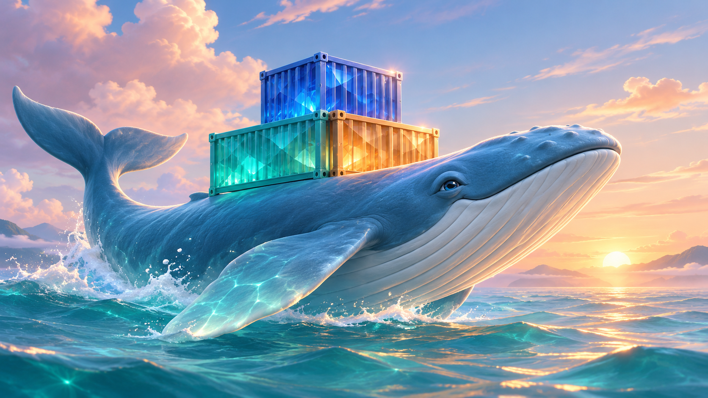
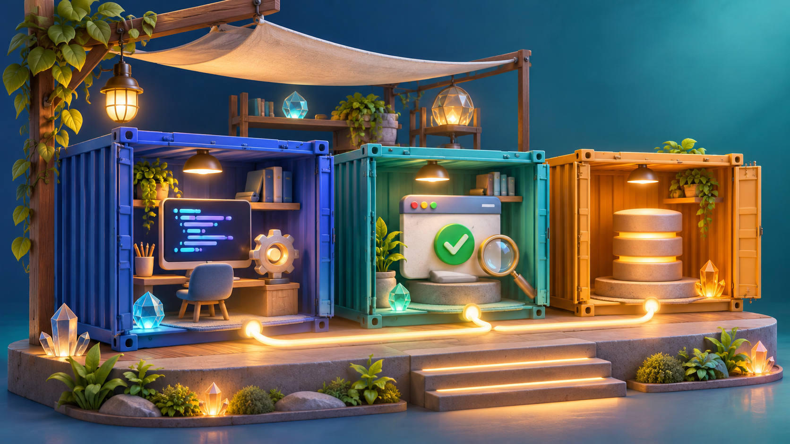

# Docker Gems art

These three pictures use blue containers, clear gems, and warm light.
The built-in image generator made the pictures.

## A harbor of possibilities

A blue whale carries three gem containers across the sea at dawn.

## Small containers, big possibilities

Three containers hold tools for code, tests, and data.

## Build your next horizon

A path of containers leads from a laptop to the sunrise.

